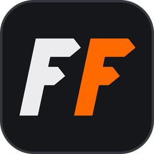

<p align="center"></p>

A tool to convert BO3 customs to PS4 and a SPRX to load them on HEN consoles.

## What you need

- A HEN console with BO3 **version 1.33** (**any region**).
- **BO3 installed on PC**, plus the maps or mods you want to port.
- The tool, `Console.zip` and the SPRX from the [Releases](../../releases) page.

## Getting started

1. Extract `Console.zip` and copy it to `/data/` on your console.
2. Put the SPRX anywhere you like, preferably in `/data/BO3-Customs/`.
3. Run the tool, drop a Steam map or mod into it, press **Convert** and wait for it to finish.
4. Copy the converted map into `/data/BO3-Customs/usermaps/`. Mods go in `/data/BO3-Customs/mods/`.
5. Launch the game and load the SPRX with your preferred method.

If your console runs an FTP server, the tool does steps 1, 2 and 4 for you: see **Sending to the console**.

## The tool

- **Convert**: drop maps or mods in, or use **Add** to pick from what you have installed.
  Each one gets a score when it is done. 99% means everything came across; anything lower lists what to look at.
- **Converted**: everything you have converted, ready to send to the console.
- **Community**: maps and mods that are already converted, ready to download.
- **Installed**: what is on your console. Maps and mods can be removed from here.
- **Settings**: your console, where maps are sent, and updates.

Converted files go to the `exports` folder beside the tool unless you choose another one.
The tool updates itself when a newer release is out.

## Sending to the console

1. Open **Settings**, enter your console's IP address and press **Test**.
   The port is 2121 unless you add another, like `192.168.1.50:21`.
2. **Console files** downloads `Console.zip` and the newest SPRX and sends them to the console.
3. Press **Send to console** on anything you converted or downloaded.

- **Auto-FTP** sends everything by itself as soon as it is converted or downloaded.
- **Send to** picks where maps and mods go: the console's own storage, a USB drive or extended storage.

## USB and extended storage

Maps and mods can also sit on a USB drive or extended storage, in a `BO3-Customs` folder at the root of the drive
(`BO3-Customs/usermaps/` and `BO3-Customs/mods/`). Everything else stays in `/data/BO3-Customs/`.

## LAN games

When you join a LAN game and do not have the host's map or mods, the SPRX downloads them from the host and then loads you in.
Both consoles need this SPRX and must be on the same network. Circle cancels the download; the next join carries on from there.

## Found a problem?

[Open an issue](../../issues) and provide `/data/BO3-Customs/log.txt` from your console.
Grab it before you start the game again: every launch starts a new log.

Also attach the tool's log for the map that causes the issue: press **Log** in the tool, then **Save**.
If the tool was closed since, its logs are in `work\analysis\gui_logs` beside the tool.

## Console Layout
```text
/data/BO3-Customs/
├── BO3-Customs.sprx
├── ui_scripts/
│   ├── graphics.lua
│   ├── kbm_strings.lua
│   ├── mapselect.lua
│   ├── maptable.lua
│   ├── mods.lua
│   ├── mouse.lua
│   └── restart.lua
├── lui/
│   └── ui/
│       ├── t7/
│       │   └── utility/
│       │       └── pcutility.lua
│       └── uieditor/
│           ├── menus/
│           │   └── mods/
│           │       └── menumodsload.lua
│           └── widgets/
│               └── mods/
│                   ├── entrymodsload.lua
│                   └── widgetmodsload.lua
├── zone/
│   ├── en_zm_levelcommon.ff
│   ├── en_zm_levelcommon.xpak
│   ├── zm_levelcommon.ff
│   ├── zm_levelcommon.xpak
│   └── snd/
│       ├── all/
│       │   ├── zm_levelcommon.all.sabl
│       │   └── zm_levelcommon.all.sabs
│       └── <lang>/
│           ├── zm_levelcommon.<lang>.sabl
│           └── zm_levelcommon.<lang>.sabs
├── mods/
│   └── <mod>/
│       ├── workshop.json
│       ├── core_mod.ff
│       ├── zm_mod.ff
│       └── ...
└── usermaps/
    └── <map>/
        ├── previewimage.png
        ├── loadingimage.png
        ├── workshop.json
        ├── <map>.ff
        ├── <map>.xpak
        ├── <lang>_<map>.ff
        ├── <lang>_<map>.xpak
        ├── snd/
        │   └── <lang>/
        │       ├── <map>.<lang>.sabl
        │       └── <map>.<lang>.sabs
        └── video/
            └── <name>.mkv
```

## Building

- **The SPRX**: VS 2022, PS4 SDK 12.00, .NET 10.0 SDK and Python 3.
- **The tool**: .NET 10.0 SDK.

```text
cd Tool
dotnet publish src/FFPorter.Desktop.T7/FFPorter.Desktop.T7.csproj -p:PublishProfile=FolderProfile
```

The single exe lands in `Tool/publish/`.

## Credits

- **ItsJokerZz** — SPRX and port development.
- **flatz** — `downgrade_elf.py` and `make_fself.py`.

## License

GPL-3.0-or-later — see [LICENSE](LICENSE).

Copyright (C) 2026 ItsJokerZz

This program is free software: you can redistribute it and/or modify it under the terms of the GNU General Public License
as published by the Free Software Foundation, either version 3 of the License, or (at your option) any later version.
It is distributed in the hope that it will be useful, but WITHOUT ANY WARRANTY; without even the implied warranty of
MERCHANTABILITY or FITNESS FOR A PARTICULAR PURPOSE. See the GNU General Public License for more details.
